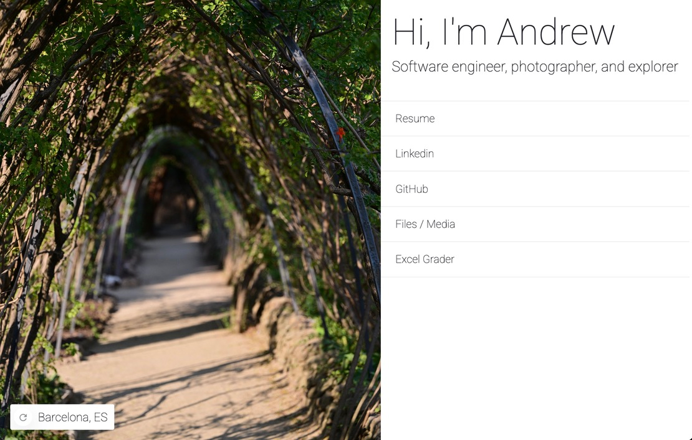

# Kaminski.pw Site Source

Personal website source code. Features image gallery and external link collection. 
Written in Typescript with Angular

Live verison can be found at [kaminski.pw](https://kaminski.pw).

## Screenshots

